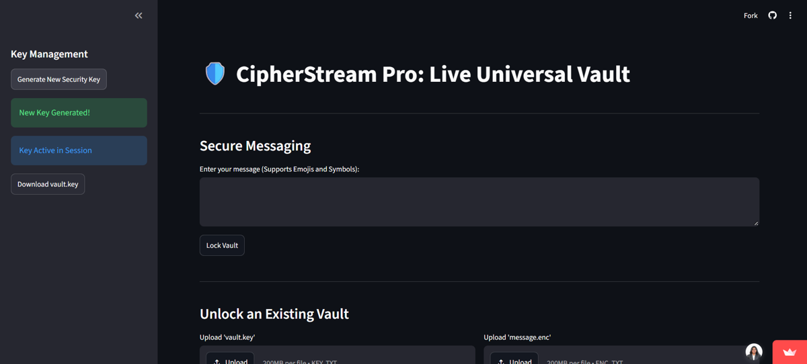
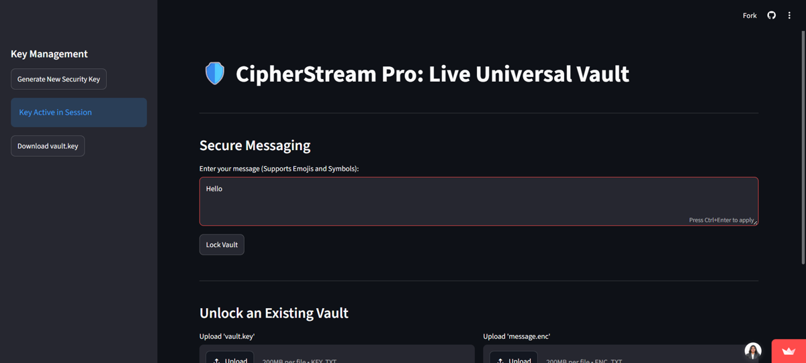
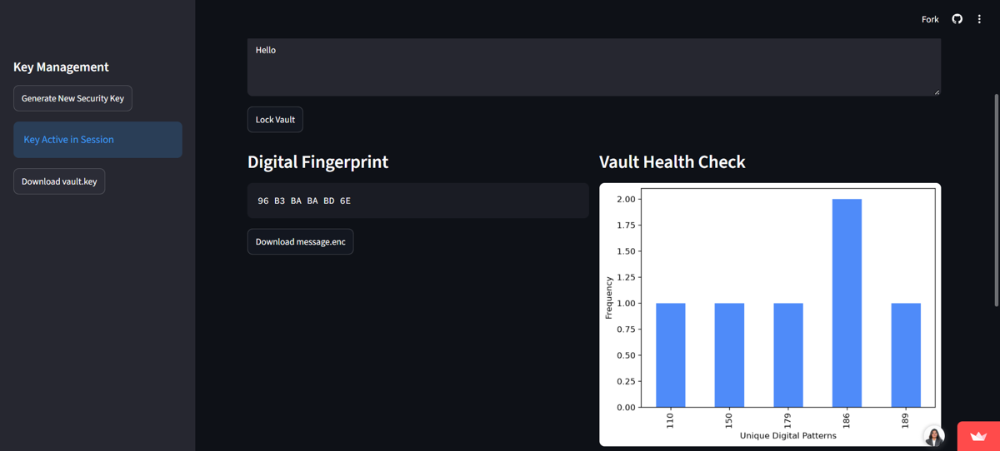
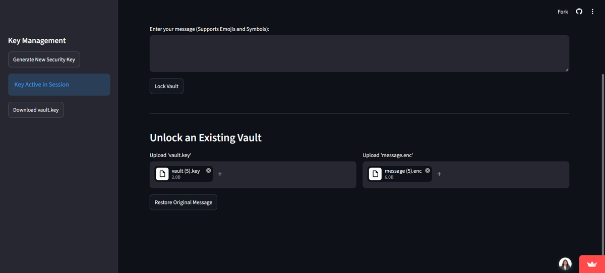
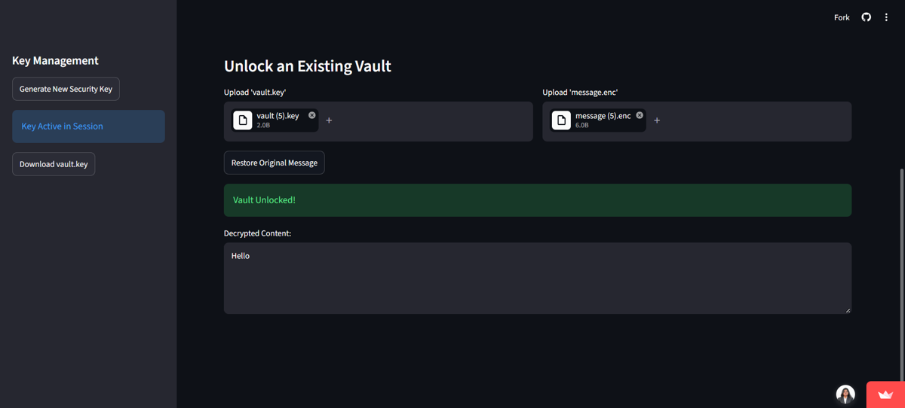

# Use the app

By the end of this guide, you will have locked a message, saved the two files that hold it, and restored the original message.

CipherStream Pro uses two files:

- `vault.key` is your security key.
- `message.enc` is your locked message.

You need both files to unlock a message.

!!! warning "Download your key before you close the tab"
    The key exists only in your current browser session. The app warns that it will vanish when you close the tab. Download `vault.key` as soon as you generate it.

## Before you begin

Open the [live demo](https://cipherstream-pro-5uqutxcjur3ifz9mbircs3.streamlit.app/), or [run the app on your computer](getting-started.md).

## Lock a message

1. In the sidebar, under **Key Management**, click **Generate New Security Key**.

    The sidebar shows **New Key Generated!** and **Key Active in Session**.

    

2. Click **Download vault.key** and save the file somewhere you can find it.

3. Under **Secure Messaging**, click the message box and type your message. The box supports emojis and symbols.

    

4. Click **Lock Vault**.

    Two results appear:

    - **Digital Fingerprint** shows your locked message as a row of hexadecimal values.
    - **Vault Health Check** shows a bar chart of how often each unique digital pattern appears in your locked message.

    

5. Click **Download message.enc** and save the file.

## Unlock a message

1. Scroll down to **Unlock an Existing Vault**.

2. Under **Upload 'vault.key'**, click **Upload** and choose your key file.

3. Under **Upload 'message.enc'**, click **Upload** and choose your locked message file.

    The upload boxes accept `.key` and `.txt` files for the key, and `.enc` and `.txt` files for the message, up to 200 MB each. Your browser may add a number to a downloaded file name, such as `vault (5).key`. You can upload the file with that name.

    

4. Click **Restore Original Message**.

    A green **Vault Unlocked!** message appears, and your original message is shown under **Decrypted Content**.

    

## If something goes wrong

**The sidebar says "No key found. Generate one to start."**
You have not created a key in this session yet. Click **Generate New Security Key**.

**You closed the tab before downloading `vault.key`.**
The key is lost, and you need it to unlock a message. Reopen the app, generate a new key, and lock your message again. Always download `vault.key` first.
